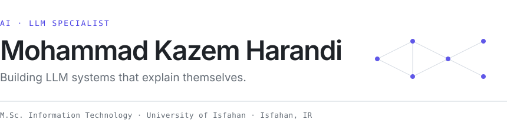
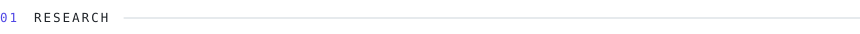
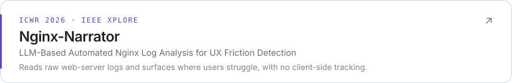
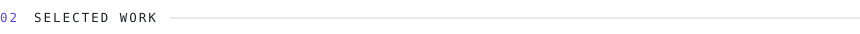
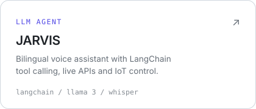
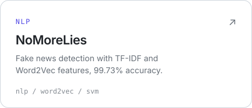
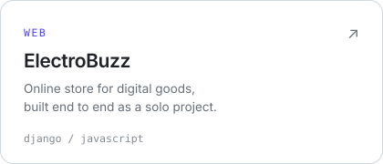
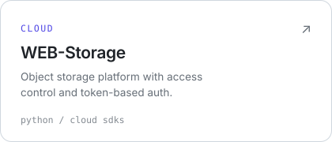
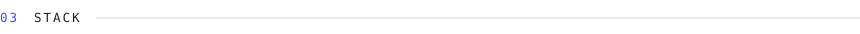
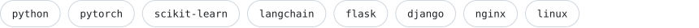

  <a href="https://www.linkedin.com/in/mohammad-kazem-harandi">LinkedIn</a>&ensp;·&ensp;
  <a href="https://scholar.google.com/citations?user=20FcfowAAAAJ">Google Scholar</a>&ensp;·&ensp;
  <a href="mailto:harandi.mohamma@gmail.com">harandi.mohamma@gmail.com</a>

 

  

  
  

  
  

 

